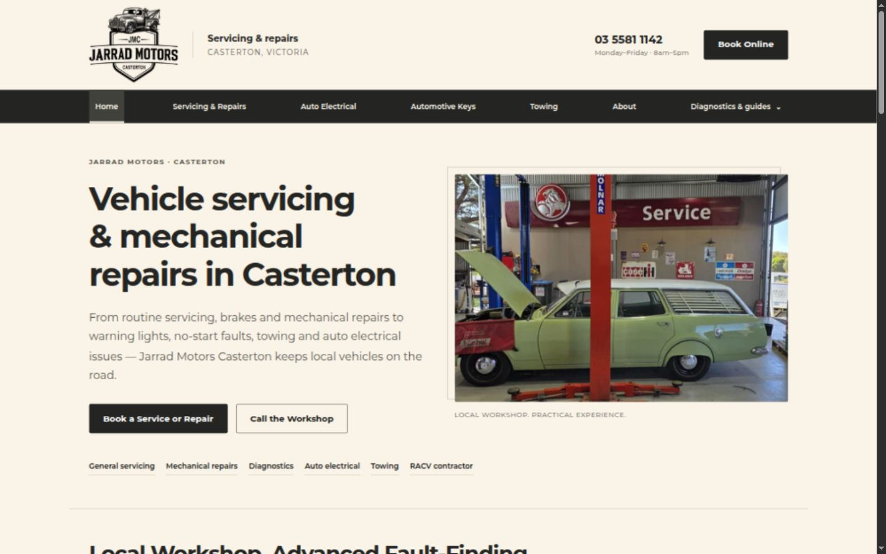
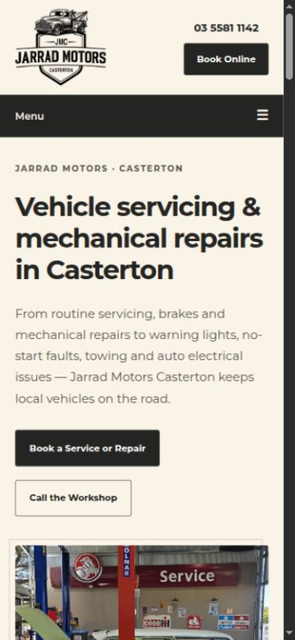
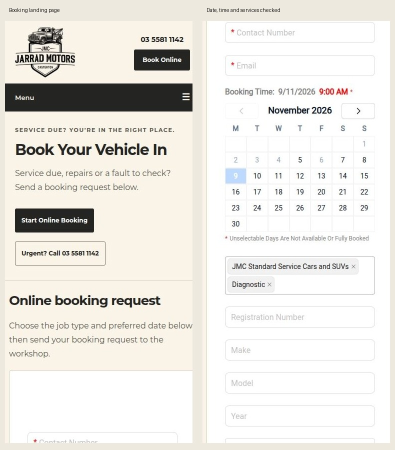
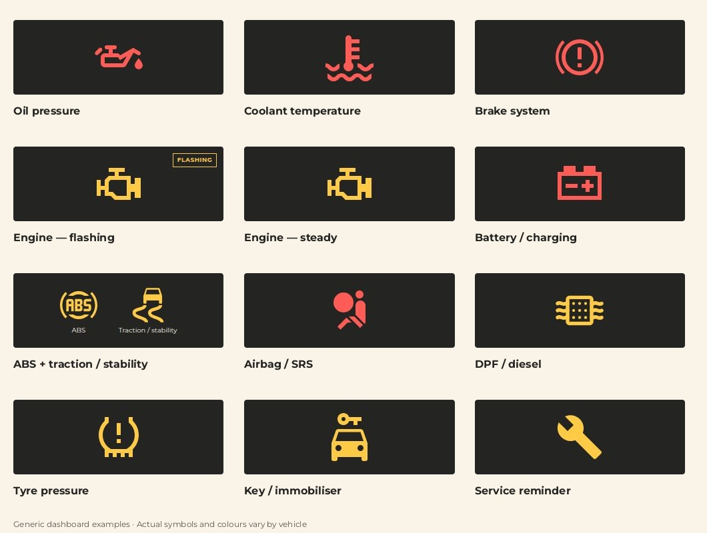
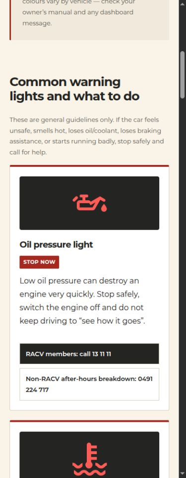

# Brand first pass — 5 November 2026

## Assessment and direction

The existing black/red theme, Arial, old logo disc, duplicated inline CSS and twelve-link navigation felt disconnected from the new printed branding. The replacement uses warm ivory, charcoal, Montserrat, the approved engraved V2 badge, white reading surfaces, simple borders and consistent spacing. No artificial paper texture was added. Genuine workshop photography is more visible rather than obscured by a dark overlay.

General servicing and mechanical repairs lead the homepage. Diagnostics, auto electrical, automotive keys and towing support that core offer. Reviews and useful service content are retained. The booking landing page recognises customers arriving from a service sticker and provides an immediate form anchor and urgent phone link.

All thirteen styled HTML pages share the same header, compact mobile navigation, footer, typography, buttons and focus rules. This includes the service pages, About, booking, diagnostic resources, Kids Corner and 404. Existing redirect files are unchanged.

## Verification

- Read current repository contents and inspected the live homepage and booking page before editing. The latest successful GitHub Pages build targets `main` at `706c314d3e15c334f2132e580ad1f90f320051c0`; no production changes were made for this review.
- Checked all thirteen styled pages in the browser at 390px and 1440px; checked homepage, booking and warning guide at 320px and 768px. No outer-page horizontal overflow or failed images were observed. Checked corresponding local asset and anchor targets throughout all pages.
- Preserved existing titles, descriptions, canonical tags, telephone/email targets, review text, structured business data, CNAME, sitemap, robots and all four legacy redirect files. The only structured-data change is the verified replacement of superseded brand imagery. Added favicon, touch-icon, theme colour and Open Graph/social metadata.
- Checked badge transparency, aspect ratios and small rendered sizes. Web exports use the approved supplied artwork, without redrawing lettering or the truck. The full badge was unsuitable as a tiny favicon; the approved truck component provides a clearer small icon.
- Browser-derived text contrast checks found no AA text-contrast failures on the site's own rendered text; the lowest measured pair was 5.99:1. This is a focused contrast check, not a complete accessibility certification. The external iframe is outside these CSS checks.
- Verified the skip link and visible keyboard outline. Tested mobile menu Enter/open and Escape/close/focus restoration, and desktop resource disclosure Enter/open and Escape/close/focus restoration.
- Verified the existing key-cutting video loads with controls and no media error. Contact targets were checked without launching phone calls or composing emails.
- Rechecked the embedded MechanicDesk calendar, time picker and service selector in the final page. Selected 9 November 2026, 9:00am and service options; date/time and selected services appeared in the form. No name, phone, email or vehicle details were entered, no CAPTCHA was solved, and no booking request was submitted.
- Increased the iframe height to give the provider controls more vertical room at phone and desktop sizes. At very narrow widths the embedded provider's minimum width is accommodated by horizontal scrolling inside the form container; outer page navigation and content remain responsive.
- No framework, build dependencies, hosting migration or deployment workflow changes. No private reference material, supplier links or account screenshots are included.

## Limits and publication

The provider owns its form styling, labels, calendar availability and CAPTCHA. Visible control checks do not prove booking delivery. No completed booking, CAPTCHA or email delivery test was performed. Browser checks used desktop responsive viewports, not physical iOS/Android devices. Social card appearance in a real shared post remains dependent on each platform's crawler/cache and can be checked after approved publication.

This is a review branch. Merge/publication requires the owner's final approval. GitHub Pages has no branch preview configured; screenshots and a local static server provide the review surface.

## Screenshots

## Warning-symbol follow-up — 5 November 2026

Replaced the original rough inline drawings with recognisable local SVG pictograms: oil can/drop, thermometer over coolant, brake warning, engine outline, battery terminals, ABS, skidding car, seated passenger/airbag, particulate filter, tyre cross-section, car/key and service spanner. The symbols now have consistent size and clear dashboard panels. Battery/charging and SRS examples are red; the service example is amber. Actual manufacturer colours vary.

The ABS/traction card shows both distinct symbols. Flashing and steady engine warnings use the same conventional outline, with a static “Flashing” label for the first example. There is no flashing animation. The page loads the maintained SVG files directly, replacing duplicated inline copies. Existing SVG URLs remain available, including the legacy flashing-engine asset. The guide's CSS reference is versioned so an earlier cached layout cannot break the expanded symbol panels.

Most geometry comes from licensed Pictogrammers Material Design Icons; the generic DPF pictogram is an original filter/dots/exhaust drawing. Provenance, pinned upstream source, modifications and Apache licence are recorded in [the artwork notes](../assets/warning-lights/README.md). No manufacturer images or icon-font dependencies are shipped.

Verified all 13 symbol images across the 12 cards at 320, 390, 768 and 1440px; all loaded with no page/card overflow. Red and amber artwork contrast against charcoal is 5.12:1 and 10.21:1 respectively. All 12 card headings, advice, status text, action links and SEO metadata were preserved. The booking page and its embed were untouched by this follow-up. Symbols and colours are examples; the page directs drivers to their owner's manual and dashboard messages.

